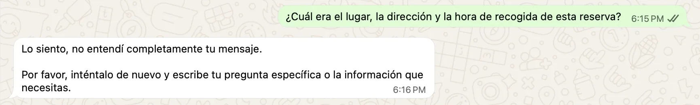
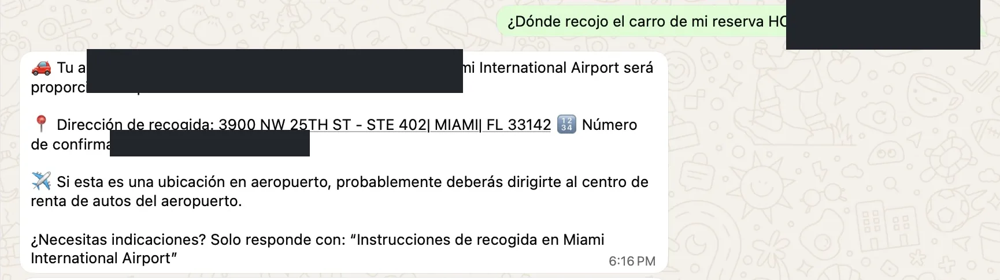
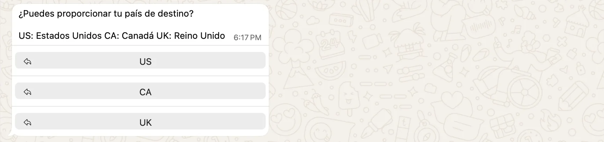
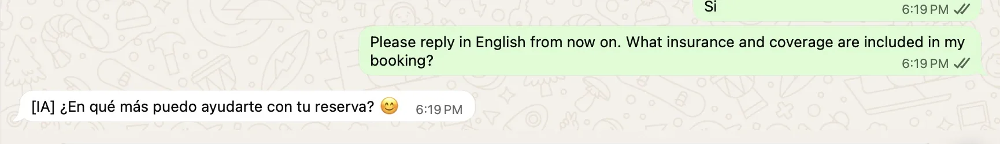

# Hola Car Rentals — WhatsApp customer-service automation

An English-language portfolio case study by Sebastián Espíndola. I designed and implemented the customer-service automation end to end during my time at Hola Car Rentals. This is a description of the customer experience and the operating problem it addressed, not a release of company source code or internal configuration.

The live walkthrough below used **my own rental reservation** on 2 November 2026. The original WhatsApp exchange was in Spanish. To preserve authentic evidence while making the project useful to English-speaking recruiters, each screenshot has a short English translation beside it. Booking, email, phone, and supplier-confirmation identifiers are excluded or covered in every image.

## The operational problem

A car-rental support team receives many repeat questions: “Is my booking confirmed?”, “Where do I pick up the car?”, “What coverage is included?”, and “Can you resend my confirmation?” Before automation, each question can require an agent to identify the customer, locate a reservation, interpret supplier information, and compose a response. That creates avoidable queue volume and variable response quality. Pre-booking questions add another stream of repetitive work.

The automation aims to answer routine questions quickly, collect enough information to locate the right booking, and give agents more time for exceptions that need human judgment. The design challenge is not just generating friendly text: it is keeping customer-facing answers aligned with booking records and guiding the caller through the right next step.

## My role and solution

I owned the automation from initial design through implementation. The customer-facing flow combines free-text questions, guided choices, reservation verification, booking-data retrieval, and action-specific paths such as confirmation-email resend. The screenshots establish the behavior visible to a customer; they do not expose the private systems or code behind it.

The technologies I used were:

| Component | Role in the project |
| --- | --- |
| WhatsApp Business API | Customer messaging channel and guided replies |
| Zendesk integration through REST APIs | Connection between the automation and the support workflow |
| Shopify-linked MySQL databases | Booking/order data used by the automation |
| Postman | Development-time testing of REST API requests and responses; **not** a production runtime component |

“Shopify-linked MySQL databases” describes the data relationship at a safe, high level; it does not imply direct access to Shopify's internal databases. I have not named an AI model, provider, or retrieval architecture because those details have not been established for this public case study.

At a logical level, the experience is:

```text
Customer question through WhatsApp Business API
        ↓
Automation logic: recognize the task or ask a clarifying question
        ↓
For booking-specific requests: collect the order reference and verify the booking email
        ↓
Retrieve booking/order information from Shopify-linked MySQL data
        ↓
Present a focused answer or action choice; connect to Zendesk support workflow as needed
```

The diagram describes the project at a logical level. It is **not a claim that a Zendesk handoff was verified in this walkthrough**. Internal endpoint details, credentials, prompts, and operational metrics are intentionally omitted.

## Customer walkthrough and evidence

### 1. Identifying a reservation

The bot asked for an order reference and then the email used for the booking. A guided yes/no confirmation completed the email step. It returned an “active and confirmed” status plus the rental supplier. This proves a customer-side lookup path exists. It does **not** prove the status label correctly reflects a completed rental: my trip was earlier in 2026, so the semantics of “active” deserve a separate data-quality check. The response also omitted the dates and vehicle I had asked for in the broader question.

The screenshot below stops before I entered the email address; the raw capture containing identifiers stays private.

<table>
<tr><th>Original WhatsApp exchange (Spanish)</th><th>English translation</th></tr>
<tr><td></td><td valign="top">Customer: “Can you give me the reservation’s dates, pickup location, vehicle, and status?”<br><br>Bot: “Sure, I can help by checking your order status. Could you confirm the email address you used to make the reservation?”<br><br><strong>Observation:</strong> The bot initiated booking verification, but narrowed a multi-part request to status.</td></tr>
</table>

### 2. Getting pickup information

I first asked for the pickup place, address, **and time** in one message. The bot could not interpret that compound request and asked for a more specific question:

<table>
<tr><th>Original WhatsApp exchange (Spanish)</th><th>English translation</th></tr>
<tr><td></td><td valign="top">Customer: “What were the pickup place, address, and time for this reservation?”<br><br>Bot: “Sorry, I didn’t fully understand your message. Please try again and write your specific question or the information you need.”</td></tr>
</table>

A shorter follow-up—“Where do I pick up the car?”—returned the rental supplier, the Miami International Airport pickup address, and airport rental-center guidance. It did **not** answer the requested pickup time. The order and supplier confirmation references are covered with opaque blocks:

<table>
<tr><th>Original WhatsApp exchange (Spanish, redacted)</th><th>English translation</th></tr>
<tr><td></td><td valign="top">Customer: “Where do I pick up the car for my reservation [redacted]?”<br><br>Bot: “Your rental car at Miami International Airport will be provided by Avis. Pickup address: 3900 NW 25TH ST - STE 402, Miami, FL 33142. For an airport location, you may need to go to the rental-car center. Need directions? Reply with ‘Pickup instructions at Miami International Airport.’”<br><br><strong>Observation:</strong> Location was returned; pickup time was not.</td></tr>
</table>

This pair of messages is a useful product lesson: the lookup can answer a focused question, but the experience is weaker when a customer asks for several related details at once. A better flow would either answer each requested field or ask which one to handle first.

### 3. Asking about insurance and English-language support

When I asked what insurance and coverage were included, the bot requested the destination country and then asked me to confirm it. That shows a structured clarification step. After I explicitly asked in English for the coverage in my booking, however, the bot replied in Spanish with a generic follow-up. It did not provide the coverage details in this test.

<table>
<tr><th>Original WhatsApp exchange (mostly Spanish)</th><th>English translation</th></tr>
<tr><td></td><td valign="top">Bot: “Can you provide your destination country?”<br><br>Guided choices: United States, Canada, United Kingdom.<br><br><strong>Observation:</strong> The bot asked for a relevant detail before discussing coverage.</td></tr>
<tr><td></td><td valign="top">Customer: “Please reply in English from now on. What insurance and coverage are included in my booking?”<br><br>Bot: “How else can I help with your reservation?”<br><br><strong>Observation:</strong> The coverage answer and language switch did not happen.</td></tr>
</table>

This is an observed limitation, not a successful insurance-answer example. The confirmation email for my booking contains coverage details, but this walkthrough did not establish that the bot could retrieve or explain them.

### 4. Confirmation-email resend

I requested a resend of the confirmation email. The bot offered two choices: send it to the email already associated with the reservation, or provide a different email. The conversation was interrupted before a choice was completed, so **no email resend or delivery was verified**. The workflow design is visible, but I am not presenting an untested action as a completed outcome.

### 5. Email change and pre-booking questions

I did not change the email address on the reservation. That is a record-modifying action and needs a clearly specified new address and appropriate verification. A separate earlier customer interaction covered general pre-booking questions, but this case study concentrates on the reservation workflow tested above. Neither email-change completion nor a full pre-booking journey is claimed as verified here.

## What I would improve next

1. **Handle compound requests:** decompose “pickup location, time, and vehicle” into fields instead of falling back on the entire message.
2. **Make language selection persistent:** once a customer asks for English, use it for subsequent prompts and answers, including guided replies.
3. **Return booking-specific coverage carefully:** cite the actual reservation terms, distinguish included coverage from optional products, and avoid generic insurance claims.
4. **Clarify status semantics:** distinguish booking confirmation, rental start, completion, and cancellation rather than showing an old booking as simply “active.”
5. **Measure completion honestly:** track whether a customer received the requested answer or email, not merely whether the bot produced a reply.

## Evidence and privacy

The public screenshots are privacy-safe crops of my own verified WhatsApp conversation. The full original captures remain excluded from version control. No customer data belonging to another person, private source code, API keys, environment variables, prompts, or internal metrics are included. This is a personal portfolio case study, not an official Hola Car Rentals product announcement.

For a compact scenario-by-scenario record, see [TEST_LOG.md](TEST_LOG.md).
